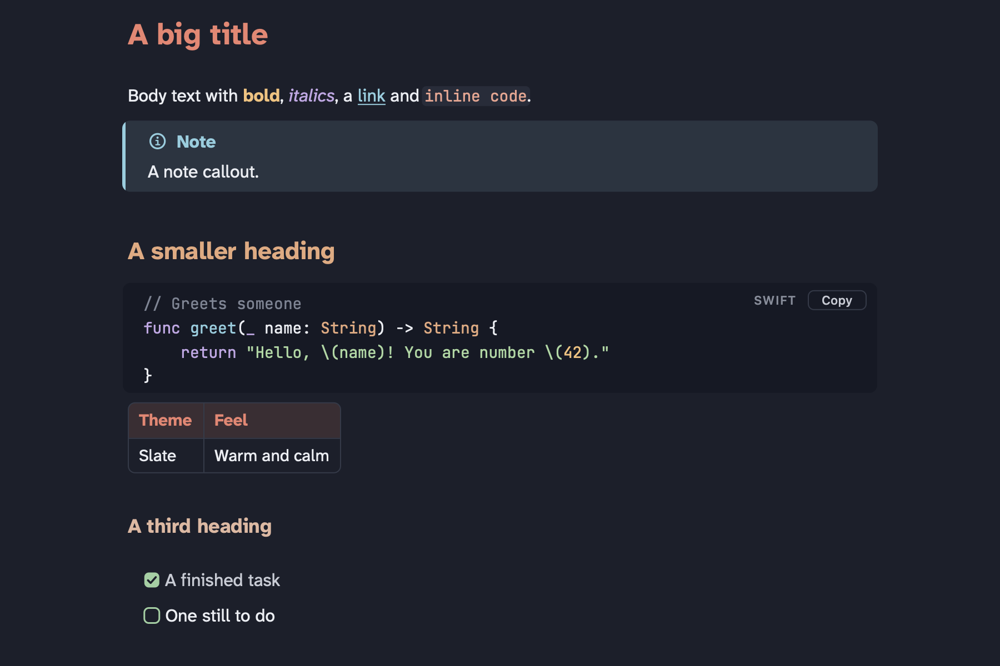
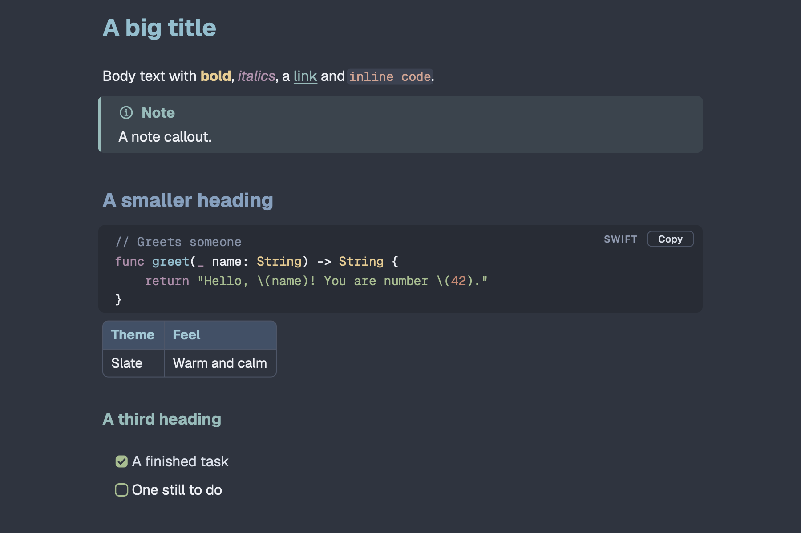
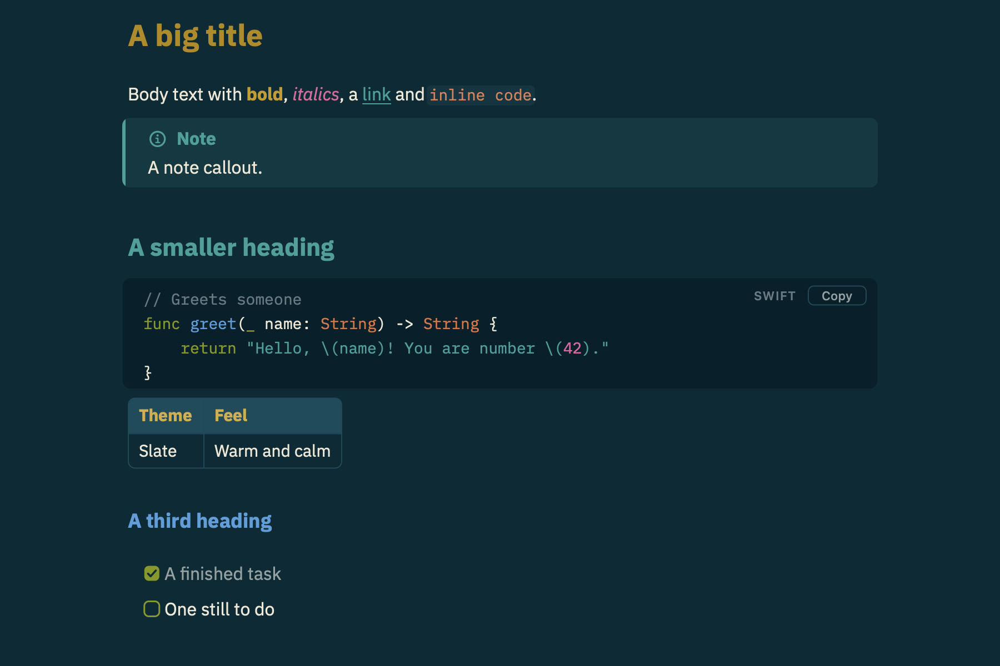
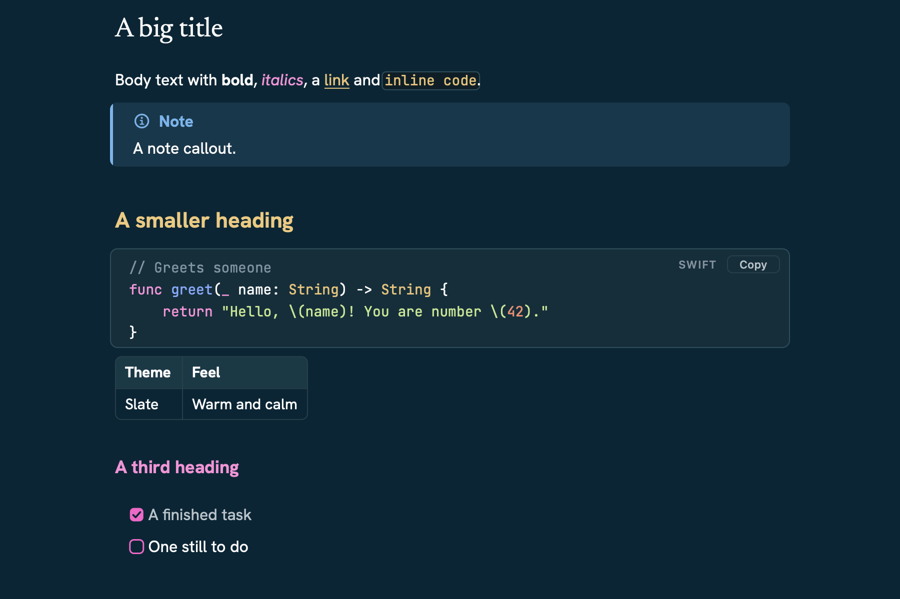
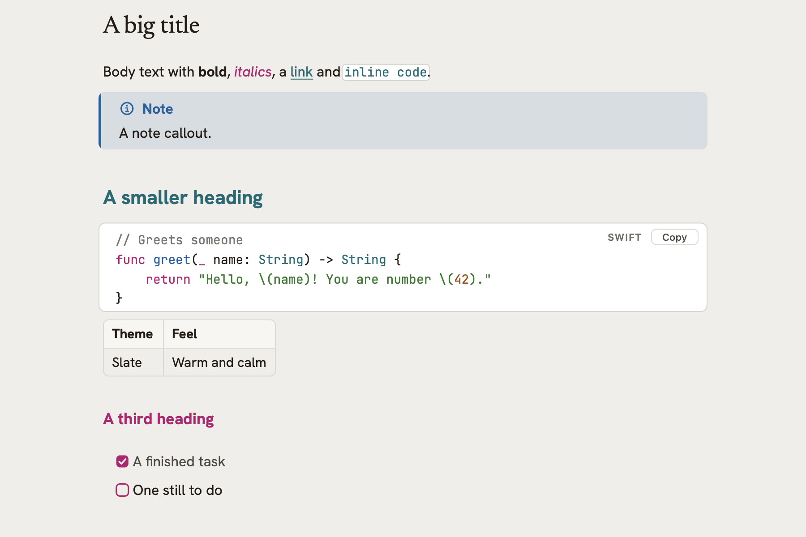
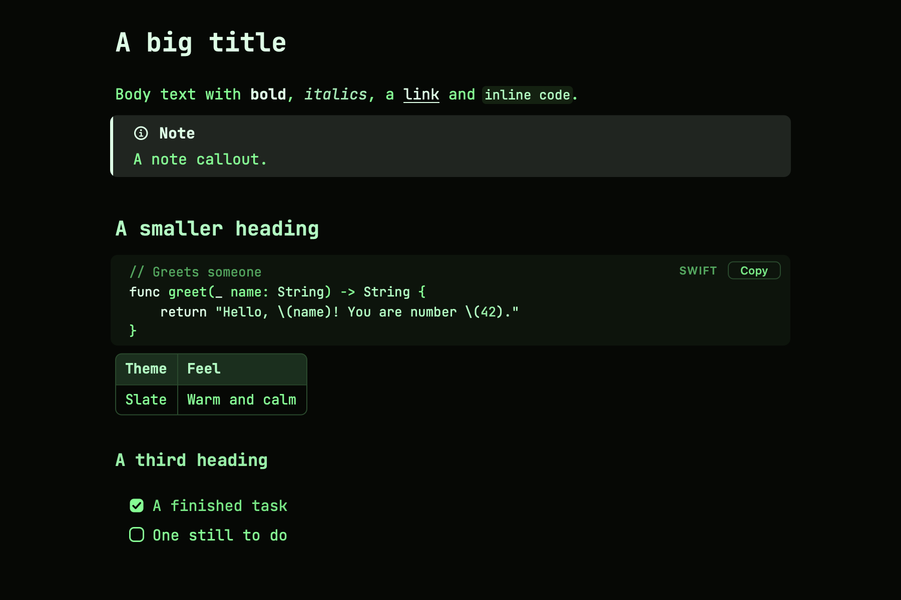

# Themes

Claudette has six themes: five dark and one light. Each has its own fonts and colors, chosen together. Pick one under View → Theme.

All fonts ship inside the app under the SIL Open Font License; their licenses are in [App/Fonts](../App/Fonts). The colors are checked by tests: body text, links, bold, italics and code colors are at least 4.5 to 1 against their background (the WCAG AA level), and headings and comments at least 3 to 1.

The source of truth is [App/Theme.swift](../App/Theme.swift). A test fails if a theme changes there and this page doesn't.

**Sizes, in every theme:** body text is 16 points (15 in Terminal) and code 14. Headings are 1.7×, 1.35× and 1.15× the body size for `#`, `##` and `###`.

**Callouts** borrow colors that already mean something in each theme: Note uses the link color (Harbor has its own blue), Tip the checkbox color, Important italics, Warning bold, and Caution inline code.

| Theme | Text | Code |
|---|---|---|
| [Slate](#slate) | Atkinson Hyperlegible Next | JetBrains Mono |
| [Nord](#nord) | Geist | Geist Mono |
| [Solarized](#solarized) | IBM Plex Sans | IBM Plex Mono |
| [Harbor](#harbor) | Newsreader (titles), Hanken Grotesk | JetBrains Mono |
| [Harbor Light](#harbor-light) | Newsreader (titles), Hanken Grotesk | JetBrains Mono |
| [Terminal](#terminal) | JetBrains Mono | JetBrains Mono |

## Slate

The default. Warm coral, peach and gold on a blue-grey night.

**Fonts**

| Used for | Font |
|---|---|
| Headings (bold) | Atkinson Hyperlegible Next |
| Body text | Atkinson Hyperlegible Next |
| Code | JetBrains Mono |

**Page colors**

| Used for | Color |
|---|---|
| Page background | `#1B1F2B` |
| Body text | `#ECEEF3` |
| Softer text: quotes, finished tasks, the file list | `#C8CCD6` |
| Faint text: Markdown marks, dividers, code language labels | `#878D9B` |
| Cursor, list bullets and numbers | `#F0826F` |
| Inline code background | `#272C3A` |
| Code block background (and the file list and guide, unless set below) | `#151925` |
| Table lines (and selected text, unless set below) | `#343A49` |

**Text colors**

| Used for | Color |
|---|---|
| `#` titles | `#F0826F` |
| `##` headings | `#E8A87C` |
| `###` and smaller | `#E3B7A0` |
| **Bold** | `#F6C177` |
| *Italics* | `#C4A7E7` |
| Links and their underline | `#8CCFE0` |
| Checkboxes | `#9BD1A0` |
| Inline code text | `#F0A48F` |
| Quote bar | `#F0826F` |
| Table header background | `#3B2D33` |
| Table header text | `#F0826F` |

**Code colors**

| Used for | Color |
|---|---|
| Keywords (`func`, `return`) | `#C4A7E7` |
| Strings | `#A8D8A0` |
| Numbers | `#F6C177` |
| Comments | `#7E8595` |
| Function names | `#8CCFE0` |
| HTML tags | `#F0826F` |
| Attributes and JSON keys | `#F6C177` |
| Types | `#E8A87C` |

## Nord

Cool and quiet: frost blues and soft greens, after the Nord palette.

**Fonts**

| Used for | Font |
|---|---|
| Headings (bold) | Geist |
| Body text | Geist |
| Code | Geist Mono |

**Page colors**

| Used for | Color |
|---|---|
| Page background | `#2E3440` |
| Body text | `#ECEFF4` |
| Softer text: quotes, finished tasks, the file list | `#D8DEE9` |
| Faint text: Markdown marks, dividers, code language labels | `#8F9BB3` |
| Cursor, list bullets and numbers | `#88C0D0` |
| Inline code background | `#3B4252` |
| Code block background (and the file list and guide, unless set below) | `#272C36` |
| Table lines (and selected text, unless set below) | `#4C566A` |

**Text colors**

| Used for | Color |
|---|---|
| `#` titles | `#88C0D0` |
| `##` headings | `#81A1C1` |
| `###` and smaller | `#8FBCBB` |
| **Bold** | `#EBCB8B` |
| *Italics* | `#B691AF` |
| Links and their underline | `#8FBCBB` |
| Checkboxes | `#A3BE8C` |
| Inline code text | `#DBA391` |
| Quote bar | `#B48EAD` |
| Table header background | `#3F5068` |
| Table header text | `#99C9D7` |

**Code colors**

| Used for | Color |
|---|---|
| Keywords (`func`, `return`) | `#B48EAD` |
| Strings | `#A3BE8C` |
| Numbers | `#D08770` |
| Comments | `#8391A8` |
| Function names | `#88C0D0` |
| HTML tags | `#81A1C1` |
| Attributes and JSON keys | `#8FBCBB` |
| Types | `#EBCB8B` |

## Solarized

The classic Solarized dark colors on deep blue-green.

**Fonts**

| Used for | Font |
|---|---|
| Headings (bold) | IBM Plex Sans |
| Body text | IBM Plex Sans |
| Code | IBM Plex Mono |

**Page colors**

| Used for | Color |
|---|---|
| Page background | `#002B36` |
| Body text | `#EEE8D5` |
| Softer text: quotes, finished tasks, the file list | `#93A1A1` |
| Faint text: Markdown marks, dividers, code language labels | `#657B83` |
| Cursor, list bullets and numbers | `#2AA198` |
| Inline code background | `#073642` |
| Code block background (and the file list and guide, unless set below) | `#00212B` |
| Table lines (and selected text, unless set below) | `#0E4A59` |

**Text colors**

| Used for | Color |
|---|---|
| `#` titles | `#B58900` |
| `##` headings | `#2AA198` |
| `###` and smaller | `#4C9FDC` |
| **Bold** | `#C99A10` |
| *Italics* | `#E0679F` |
| Links and their underline | `#2AA198` |
| Checkboxes | `#859900` |
| Inline code text | `#E38050` |
| Quote bar | `#268BD2` |
| Table header background | `#0A4B5C` |
| Table header text | `#D4AE40` |

**Code colors**

| Used for | Color |
|---|---|
| Keywords (`func`, `return`) | `#859900` |
| Strings | `#2AA198` |
| Numbers | `#E0679F` |
| Comments | `#657B83` |
| Function names | `#4C9FDC` |
| HTML tags | `#4C9FDC` |
| Attributes and JSON keys | `#C99A10` |
| Types | `#E0733F` |

## Harbor

Deep teal with gold and pink, after a developer docs site. The only theme with serif titles, outlined code and a blue Note callout.

**Fonts**

| Used for | Font |
|---|---|
| `#` titles (regular weight) | Newsreader |
| Smaller headings (bold) | Hanken Grotesk |
| Body text | Hanken Grotesk |
| Code | JetBrains Mono |

**Page colors**

| Used for | Color |
|---|---|
| Page background | `#002635` |
| Body text | `#FFFEFF` |
| Softer text: quotes, finished tasks, the file list | `#B9C4CB` |
| Faint text: Markdown marks, dividers, code language labels | `#8093A0` |
| Cursor, list bullets and numbers | `#ECC271` |
| Inline code background | `#0A1E27` |
| Code block background (and the file list and guide, unless set below) | `#0B2F3B` |
| Table lines (and selected text, unless set below) | `#1E414B` |
| Outline around inline code and code blocks | `#24505C` |

**Text colors**

| Used for | Color |
|---|---|
| `#` titles | `#FFFEFF` |
| `##` headings | `#F2C878` |
| `###` and smaller | `#FF8FDA` |
| **Bold** | `#FFFEFF` |
| *Italics* | `#FF8FDA` |
| Links and their underline | `#ECC271` |
| Checkboxes | `#FF5ECA` |
| Inline code text | `#ECC271` |
| Quote bar | `#FF5ECA` |
| Table header background | `#0F3946` |
| Table header text | `#FFFEFF` |
| Note callouts | `#6CB6F0` |

**Code colors**

| Used for | Color |
|---|---|
| Keywords (`func`, `return`) | `#FF8FDA` |
| Strings | `#C3E88D` |
| Numbers | `#F78C6C` |
| Comments | `#7D96A3` |
| Function names | `#82AAFF` |
| HTML tags | `#89DDFF` |
| Attributes and JSON keys | `#C792EA` |
| Types | `#ECC271` |

## Harbor Light

Harbor by day: warm paper, near-black text, teal and pink, after the same docs site in its light mode. Window controls and scroll bars turn light with it.

**Fonts**

| Used for | Font |
|---|---|
| `#` titles (regular weight) | Newsreader |
| Smaller headings (bold) | Hanken Grotesk |
| Body text | Hanken Grotesk |
| Code | JetBrains Mono |

**Page colors**

| Used for | Color |
|---|---|
| Page background | `#EFEEEA` |
| Body text | `#241C15` |
| Softer text: quotes, finished tasks, the file list | `#4F4943` |
| Faint text: Markdown marks, dividers, code language labels | `#6F6B64` |
| Cursor, list bullets and numbers | `#B5176F` |
| Inline code background | `#FFFFFF` |
| Code block background (and the file list and guide, unless set below) | `#FFFFFF` |
| Table lines (and selected text, unless set below) | `#DCDAD3` |
| Selected text and the current file | `#CFE1E6` |
| File list and guide background | `#EFEEEA` |
| Outline around inline code and code blocks | `#D6D4CC` |

**Text colors**

| Used for | Color |
|---|---|
| `#` titles | `#241C15` |
| `##` headings | `#006B75` |
| `###` and smaller | `#B5176F` |
| **Bold** | `#241C15` |
| *Italics* | `#B5176F` |
| Links and their underline | `#006B75` |
| Checkboxes | `#B5176F` |
| Inline code text | `#006B75` |
| Quote bar | `#F03EAE` |
| Table header background | `#F7F6F3` |
| Table header text | `#241C15` |
| Note callouts | `#0B62A4` |

**Code colors**

| Used for | Color |
|---|---|
| Keywords (`func`, `return`) | `#B5176F` |
| Strings | `#2B7A2B` |
| Numbers | `#9A4F00` |
| Comments | `#77746D` |
| Function names | `#0B62A4` |
| HTML tags | `#B3261E` |
| Attributes and JSON keys | `#C0262D` |
| Types | `#006B75` |

## Terminal

Green on black, one coding font for everything.

**Fonts**

| Used for | Font |
|---|---|
| Headings (bold) | JetBrains Mono |
| Body text | JetBrains Mono |
| Code | JetBrains Mono |

**Page colors**

| Used for | Color |
|---|---|
| Page background | `#050805` |
| Body text | `#4DFF88` |
| Softer text: quotes, finished tasks, the file list | `#3FE878` |
| Faint text: Markdown marks, dividers, code language labels | `#2BA857` |
| Cursor, list bullets and numbers | `#D6FFE4` |
| Inline code background | `#10210F` |
| Code block background (and the file list and guide, unless set below) | `#0B140B` |
| Table lines (and selected text, unless set below) | `#1F4A2A` |

**Text colors**

| Used for | Color |
|---|---|
| `#` titles | `#D6FFE4` |
| `##` headings | `#9CFFBE` |
| `###` and smaller | `#7AF0A0` |
| **Bold** | `#D6FFE4` |
| *Italics* | `#8FE8B0` |
| Links and their underline | `#D6FFE4` |
| Checkboxes | `#4DFF88` |
| Inline code text | `#9CFFBE` |
| Quote bar | `#2BA857` |
| Table header background | `#14301C` |
| Table header text | `#9CFFBE` |

**Code colors**

| Used for | Color |
|---|---|
| Keywords (`func`, `return`) | `#D6FFE4` |
| Strings | `#9CFFBE` |
| Numbers | `#7AF0A0` |
| Comments | `#2BA857` |
| Function names | `#4DFF88` |
| HTML tags | `#D6FFE4` |
| Attributes and JSON keys | `#7AF0A0` |
| Types | `#9CFFBE` |
